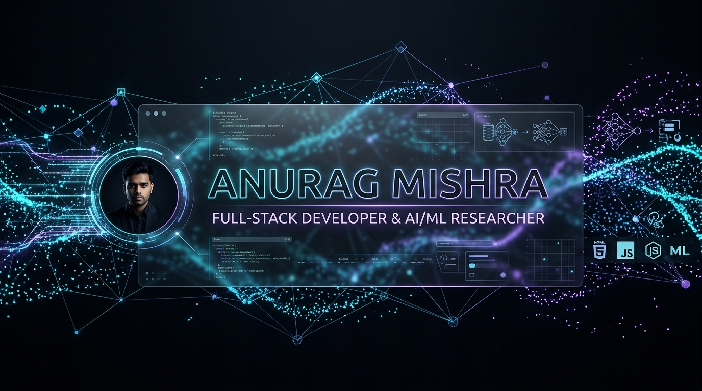

# ⚡ Anurag Mishra — Personal Portfolio Website

> A modern, award-style personal portfolio website engineered with **React 19**, **TypeScript**, **Vite**, **Tailwind CSS**, **Framer Motion**, **GSAP**, **Lenis**, and **Three.js**.



---

## 🚀 Live Demo & Links
- **Portfolio Live URL**: Deployed to Vercel
- **Companion Research Platform (HerdIntel)**: [cownet-ai.vercel.app](https://cownet-ai.vercel.app/)
- **Ayodhya Blessings**: [the-divine-of-ayodhya-main-1-ed91.vercel.app](https://the-divine-of-ayodhya-main-1-ed91.vercel.app/)
- **GitHub**: [github.com/Anurag94507](https://github.com/Anurag94507)
- **LinkedIn**: [linkedin.com/in/anurag-mishra-21b87b244](https://www.linkedin.com/in/anurag-mishra-21b87b244)

---

## 🛠️ Tech Stack & Architecture

- **Core**: React 19, TypeScript, Vite
- **Styling**: Tailwind CSS, Custom Glassmorphism, CSS Grain Shader
- **3D & Particles**: Three.js (custom GPU-accelerated constellation particle field with mouse parallax and mobile fallback)
- **Motion & Storytelling**: Framer Motion, GSAP ScrollTrigger
- **Smooth Scroll**: Lenis Smooth Scrolling (respects `prefers-reduced-motion`)
- **Icons**: Lucide React & custom SVG brand icons
- **Delight & Interactivity**: Canvas Confetti, 3D Tilt Cards, Animated Numeric Counters, Typewriter Terminal

---

## 📂 Project Structure

```text
anurag-portfolio/
├── public/
│   ├── assets/
│   │   ├── Anurag_Mishra_Resume.pdf  <-- Replace with your actual resume PDF
│   │   ├── anurag-avatar.webp        <-- Optional headshot / profile image
│   │   └── og-preview.png            <-- OpenGraph social card
│   └── favicon.svg
├── src/
│   ├── components/
│   │   ├── canvas/
│   │   │   └── HeroBackground3D.tsx   <-- Three.js particle constellation scene
│   │   ├── layout/
│   │   │   ├── Navbar.tsx             <-- Floating glassmorphic navbar & mobile drawer
│   │   │   └── Footer.tsx             <-- System status, back-to-top, quick links
│   │   ├── sections/
│   │   │   ├── HeroSection.tsx        <-- Typewriter, 3D background, magnetic CTAs
│   │   │   ├── StatsSection.tsx       <-- Animated numeric counters
│   │   │   ├── AboutSection.tsx       <-- Education standing, coursework & pillars
│   │   │   ├── ExperienceSection.tsx  <-- Scroll-drawn SVG timeline (C-DAC, IIIT, CDO)
│   │   │   ├── ResearchSection.tsx    <-- ICNACT 2026 IEEE paper & 10 audited gaps
│   │   │   ├── ProjectsSection.tsx    <-- 3D tilt cards & browser mockups
│   │   │   ├── SkillsSection.tsx      <-- Animated marquee & categorized skills
│   │   │   ├── CertificationsSection.tsx <-- Verified credentials & honors
│   │   │   └── ContactSection.tsx     <-- Validated form, confetti & copy email
│   │   └── ui/
│   │       ├── CustomCursor.tsx       <-- Spring trailing cursor with glow aura
│   │       ├── Icons.tsx              <-- Custom SVG icons (GitHub, LinkedIn)
│   │       ├── Preloader.tsx          <-- Holographic brand boot sequence
│   │       └── TiltCard.tsx           <-- 3D mouse perspective tilt
│   ├── data/
│   │   ├── personal.ts                <-- Bio, social links, contact, stats
│   │   ├── experience.ts              <-- Work history & achievements
│   │   ├── projects.ts                <-- Project cards, live URLs, metrics
│   │   ├── research.ts                <-- ICNACT 2026 paper, 10 gaps & pillars
│   │   ├── skills.ts                  <-- Categorized technical toolkit
│   │   └── certifications.ts          <-- Credentials & simulations
│   ├── App.tsx                        <-- Root application with Lenis & themes
│   ├── index.css                      <-- Global design tokens, glassmorphism & grain
│   └── main.tsx                       <-- Vite React mounting entry
├── index.html                         <-- SEO meta tags, Google Fonts & favicon
├── package.json
├── tailwind.config.js
├── tsconfig.json
└── vite.config.ts
```

---

## 💻 Local Development Setup

### 1. Prerequisites
- Node.js `v18+` or `v20+` (tested on Node v23)
- npm `v9+` or `v11+`

### 2. Installation
```bash
# Clone the repository
git clone https://github.com/Anurag94507/anurag-portfolio.git
cd anurag-portfolio

# Install dependencies
npm install
```

### 3. Run Dev Server
```bash
npm run dev
```
Open [http://localhost:5173](http://localhost:5173) in your browser.

### 4. Build for Production
```bash
npm run build
```
This generates an optimized production bundle in the `dist/` folder.

---

## 🚢 Deploying to Vercel

The portfolio is pre-configured and 100% ready for instant zero-config deployment to [Vercel](https://vercel.com):

### Option A: Using the Vercel CLI (Fastest)
```bash
# Install Vercel CLI globally (if not installed)
npm install -g vercel

# Deploy
vercel
```
Follow the interactive prompt (press Enter for default settings). For production:
```bash
vercel --prod
```

### Option B: Deploy via GitHub (Recommended for CI/CD)
1. Push this project to your GitHub repository:
   ```bash
   git init
   git add .
   git commit -m "feat: initial commit of award-grade personal portfolio"
   git branch -M main
   git remote add origin https://github.com/Anurag94507/portfolio.git
   git push -u origin main
   ```
2. Log in to [Vercel](https://vercel.com).
3. Click **"Add New Project"** and import your GitHub repository.
4. Framework Preset will automatically detect **Vite**.
5. Build Command: `npm run build`
6. Output Directory: `dist`
7. Click **"Deploy"**!

---

## 📸 Personal Media & Assets Checklist

The site comes equipped with cybernetic gradients, SVG mockups, and vector art out-of-the-box. When you're ready to personalize with your own media files, simply drop them into `public/assets/`:

1. **Resume PDF** (`public/assets/Anurag_Mishra_Resume.pdf`):
   - Replace the included placeholder PDF with your latest exported resume.
2. **Profile Headshot** (`public/assets/anurag-avatar.webp` or `.png`):
   - High-resolution headshot for the About section or OpenGraph thumbnail.
3. **Project Screenshots** (`public/assets/projects/`):
   - Replace the browser mockups in `src/data/projects.ts` with real screenshots of HerdIntel, Ayodhya Blessings, E-Commerce, and SHG System if desired.
4. **OpenGraph Share Image** (`public/assets/og-preview.png`):
   - 1200x630px social banner displayed when sharing your portfolio on LinkedIn, Twitter, and WhatsApp.

---

## 🎨 Easy Content Customization

All copy, stats, links, and projects are cleanly decoupled into TypeScript data modules inside `src/data/`:
- Edit your bio or social links in `src/data/personal.ts`
- Add new roles or update descriptions in `src/data/experience.ts`
- Add new projects or update URLs in `src/data/projects.ts`
- Update papers or conference proceedings in `src/data/research.ts`
- Update your technical toolkit in `src/data/skills.ts`

---

## 📄 License
MIT License &copy; Anurag Mishra.
